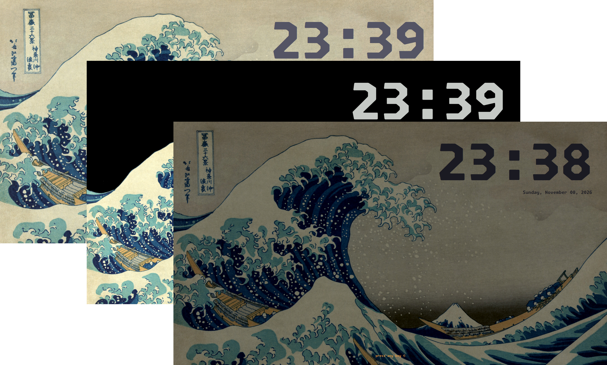
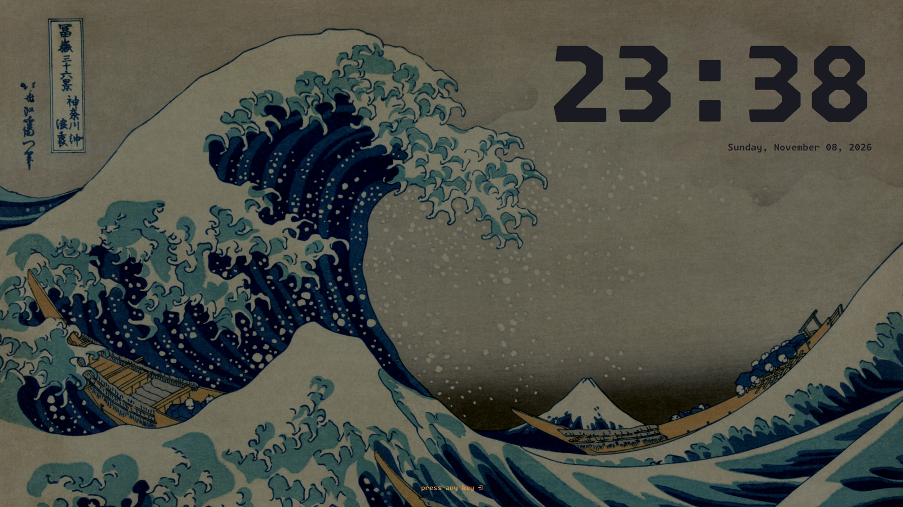
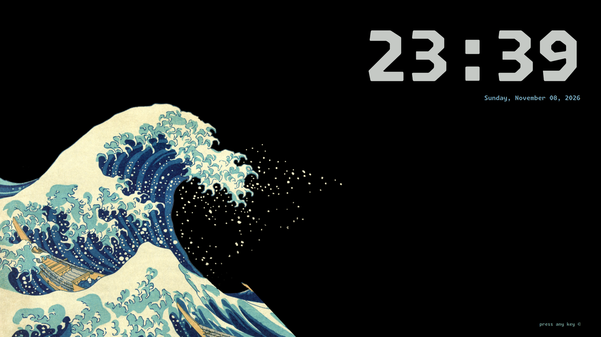
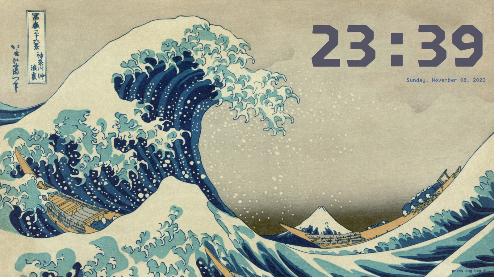

<h3>Kanagawa for <a href="https://github.com/uiriansan/SilentSDDM">SilentSDDM</a></h3>
<p>A community-maintained theme inspired by Hokusai's <em>The Great Wave off Kanagawa</em>.</p>
<p>Using the <a href="https://github.com/rebelot/kanagawa.nvim">Kanagawa palette</a> by <a href="https://github.com/rebelot">Tommaso Laurenzi (rebelot)</a>.</p>
<p>Based on <a href="https://github.com/uiriansan/SilentSDDM">SilentSDDM</a> by <a href="https://github.com/uiriansan">uiriansan</a>.</p>

<!-- Wave accents: carpYellow, crystalBlue, autumnRed. Lotus accents: lotusYellow, lotusBlue4, lotusRed. -->
<p>
  <a href="https://github.com/kanagawa-community/silent-sddm/stargazers">
    <picture>
      <source media="(prefers-color-scheme: dark)" srcset="https://img.shields.io/github/stars/kanagawa-community/silent-sddm?style=for-the-badge&amp;labelColor=1F1F28&amp;color=E6C384">
      <source media="(prefers-color-scheme: light)" srcset="https://img.shields.io/github/stars/kanagawa-community/silent-sddm?style=for-the-badge&amp;labelColor=F2ECBC&amp;color=77713F">
      
    </picture>
  </a>
  <a href="https://github.com/kanagawa-community/silent-sddm/releases/latest">
    <picture>
      <source media="(prefers-color-scheme: dark)" srcset="https://img.shields.io/github/v/release/kanagawa-community/silent-sddm?style=for-the-badge&amp;label=release&amp;labelColor=1F1F28&amp;color=7E9CD8">
      <source media="(prefers-color-scheme: light)" srcset="https://img.shields.io/github/v/release/kanagawa-community/silent-sddm?style=for-the-badge&amp;label=release&amp;labelColor=F2ECBC&amp;color=4D699B">
      
    </picture>
  </a>
  <a href="https://github.com/kanagawa-community/silent-sddm/issues">
    <picture>
      <source media="(prefers-color-scheme: dark)" srcset="https://img.shields.io/github/issues/kanagawa-community/silent-sddm?style=for-the-badge&amp;labelColor=1F1F28&amp;color=C34043">
      <source media="(prefers-color-scheme: light)" srcset="https://img.shields.io/github/issues/kanagawa-community/silent-sddm?style=for-the-badge&amp;labelColor=F2ECBC&amp;color=C84053">
      
    </picture>
  </a>
</p>

<br clear="both">
<br>

## Previews

<!-- Every port must support and preview all three variants. Keep screenshots in this port repository, and use comparable application content in each. The images in assets/ are placeholders: replace all four. -->
<!-- Terminal-based ports render the three variant images instead of taking them: see https://github.com/kanagawa-community/.github/blob/main/docs/PREVIEWS.md -->
<!-- showcase.png stacks the three variant images. Build it and the social preview with scripts/finish-previews.sh from https://github.com/kanagawa-community/.github (terminal ports: scripts/render-previews.sh with a scripts/preview.sh hook), and keep the variant images in assets/screenshots/. -->



<details>
<summary>🌊 Wave</summary>

</details>

<details>
<summary>🐉 Dragon</summary>

</details>

<details>
<summary>🪷 Lotus</summary>

</details>

## Requirements

- [SilentSDDM](https://github.com/uiriansan/SilentSDDM), installed as an SDDM theme
  (the default folder is `/usr/share/sddm/themes/silent`).
- Optionally Monaspace Krypton NF installed system-wide, from the `monaspace-nerdfonts`
  download of [Monaspace](https://github.com/githubnext/monaspace/releases/latest).
  SDDM runs as its own user, so it cannot see fonts in your home folder, and SilentSDDM
  falls back to its default font without it.

## Installation

Clone the repository and run the install script as a normal user. It asks for `sudo` to
copy one variant's preset and background into the SilentSDDM theme folder and to select
the preset in the theme's `metadata.desktop`:

```sh
./install.sh wave    # or dragon, or lotus
```

Set `SILENT_SDDM_THEME` if SilentSDDM is not in `/usr/share/sddm/themes/silent`.
`./uninstall.sh` removes the preset and its background again; it leaves `ConfigFile` in
`metadata.desktop` alone, so point it at another preset yourself.

## Usage

Log out to see the login screen. To preview it without logging out, run `./test.sh` from a
copy of the theme folder.

Dragon puts the login form on the black right of the Crest wallpaper, Wave puts it on the
right of the blurred Dim wallpaper, and Lotus centers it on the blurred restored Great
Wave. Positions are tuned for an 1800x1125 logical screen (2880x1800 at 1.6 scale).

## Backgrounds

`backgrounds/` holds the three wallpapers the presets use, copied from the
[KDE port](https://github.com/kanagawa-community/kde), which makes them from public-domain
prints by Katsushika Hokusai.

## Palette

The presets use the shared palette by role. See the
[palette](https://github.com/kanagawa-community/.github/blob/main/docs/PALETTE.md).

## Issues and contributions

Report bugs and request changes in this port's
[issue tracker](https://github.com/kanagawa-community/silent-sddm/issues). Contributions are welcome.

See [CONTRIBUTING.md](CONTRIBUTING.md) before opening a pull request.

## License

MIT. See [LICENSE](LICENSE).
